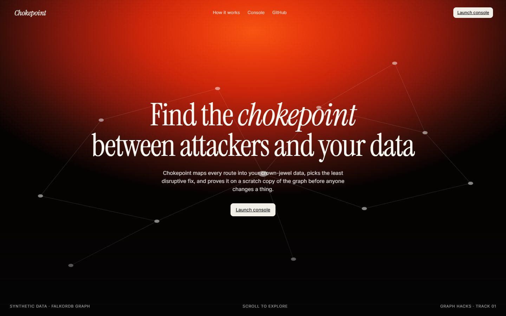
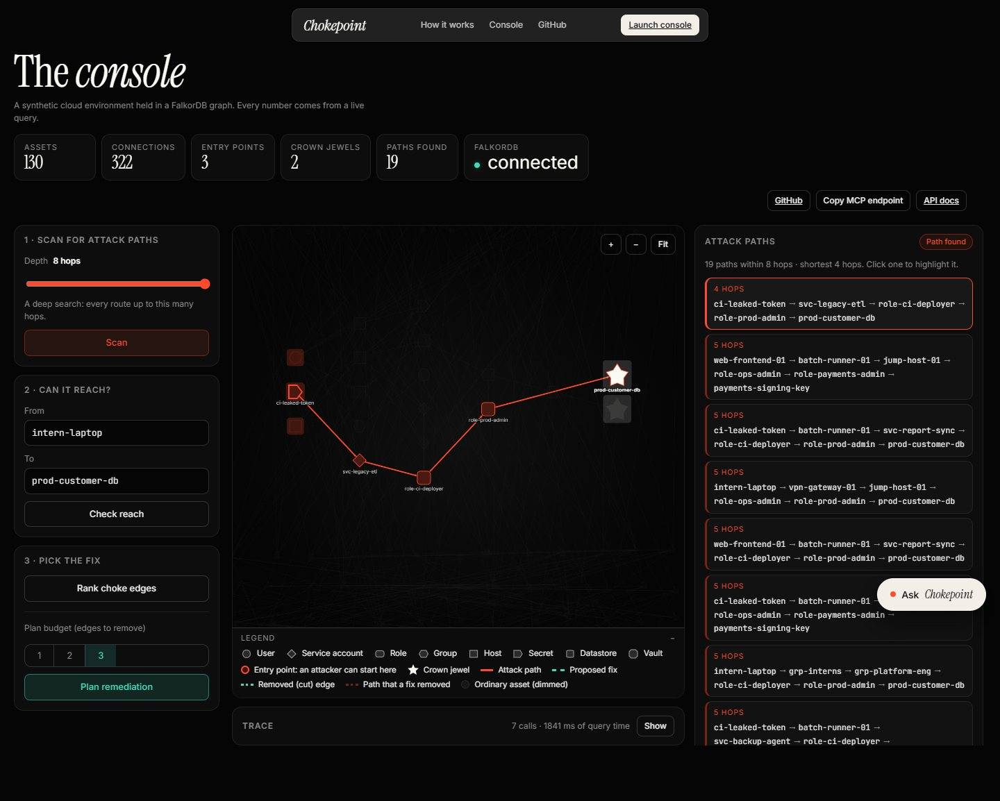
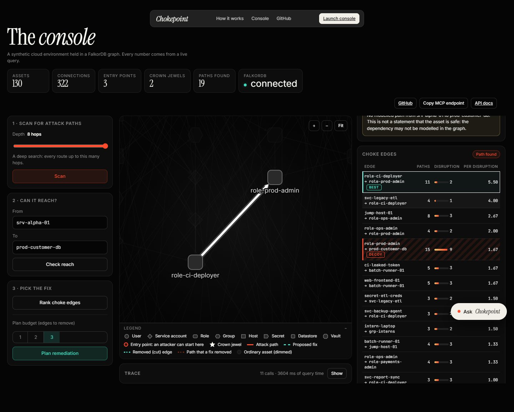
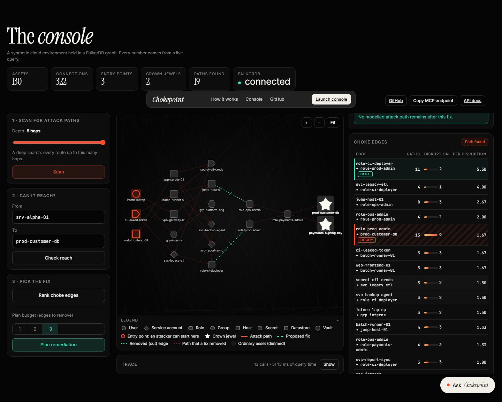
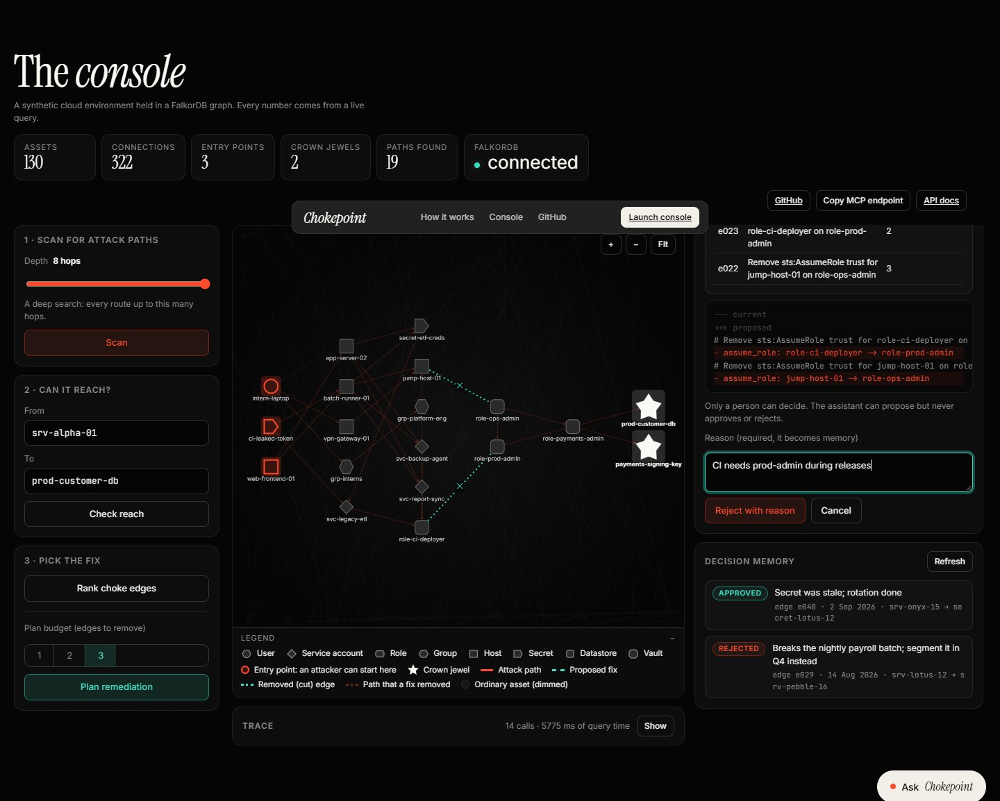
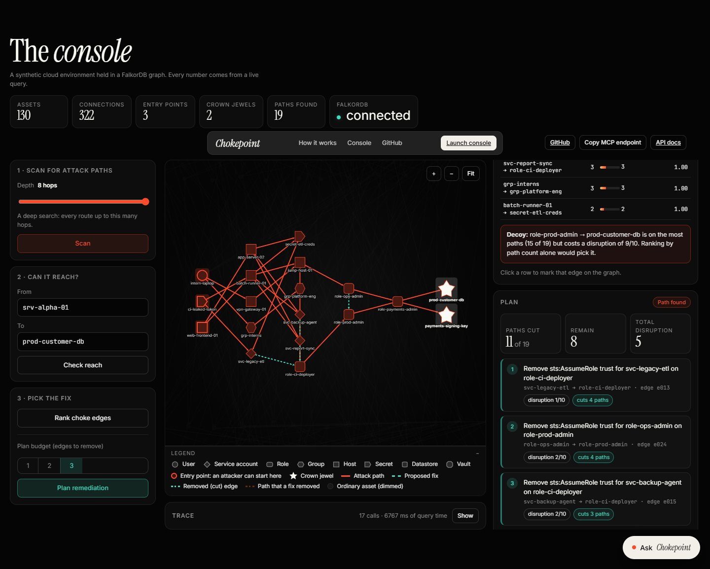
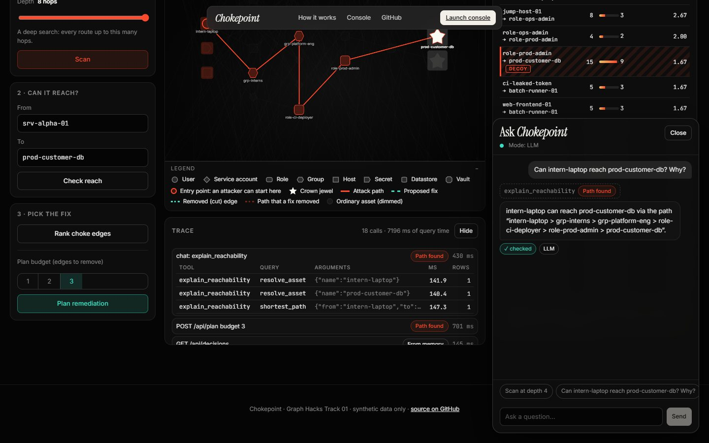
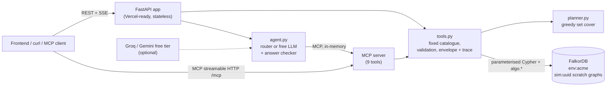

# Chokepoint

**An agent that finds the attack paths from the internet to a company's crown-jewel data in its cloud-environment graph, picks the smallest, least disruptive set of changes that cuts them, proves the fix on a scratch copy of the graph, and files a change for human approval, remembering what humans approve or reject.**

Built for **Graph Hacks: Context for AI Agents (WeMakeDevs x FalkorDB), Track 01: Agents That Act on Connected Data.**

**Demo video: https://youtu.be/8bjtyt3C3p0?si=hl3y3sZEV29P5cjV**

| | |
|---|---|
| Repo | https://github.com/Im-2/chokepoint |
| Live deployment | **https://trychokepoint.vercel.app**: landing page and console at `/`, API docs at [/docs](https://trychokepoint.vercel.app/docs), MCP at `/mcp`. Vercel + FalkorDB Cloud. |
| Demo video | _Link to be added above._ About 3 minutes 45 seconds, a real unedited run of the live site with an AI-generated voiceover. Script and how it was made: [docs/DEMO_SCRIPT.md](docs/DEMO_SCRIPT.md) |
| Study guide | [docs/WALKTHROUGH.md](docs/WALKTHROUGH.md) (design decisions + judge Q&A) |

All data is **synthetic**, generated by [`app/seed.py`](app/seed.py). No real credentials or infrastructure appear anywhere.

---

## What it does (the demo, with the real numbers from the seeded data)

1. **Depth contrast.** A scan at depth 2 finds nothing: *"No modelled attack path within 2 hops. This is not a statement that the asset is safe."* At depth 4 it finds **1** attack path, a hidden 4-hop route through a forgotten service account: `ci-leaked-token -> svc-legacy-etl -> role-ci-deployer -> role-prod-admin -> prod-customer-db`. At depth 8 there are **19** paths.
2. **Ask a question.** "Can `intern-laptop` reach `prod-customer-db`?" Yes, in 5 hops via `grp-interns`, `grp-platform-eng`, `role-ci-deployer`, `role-prod-admin` (found with FalkorDB's weighted shortest-path algorithm).
3. **Plan.** The cheapest fix is `role-ci-deployer -> role-prod-admin` (on 11 of 19 paths, disruption 2). A plain "most paths" ranking would pick `role-prod-admin -> prod-customer-db` (15 paths) but its disruption is 9. A budget of 1 cuts 11 of 19; a second edge (`jump-host-01 -> role-ops-admin`, disruption 3) cuts the remaining 8.
4. **Simulate.** The graph is copied to a scratch graph, the fix is applied there, and the path search is re-run: **19 paths before, 0 after** (with only the first edge: 19 -> 8). The scratch graph is always deleted.
5. **Propose.** A change record is written to the graph: owning team found by traversal (`platform-eng`), a ticket in markdown and a config diff. Status `proposed`.
6. **A human rejects with a reason** ("CI needs prod-admin during releases"). **Re-plan:** the agent reads past decisions from the graph, excludes that edge and chooses three cheaper edges (total disruption 6) that cut 15 of 19 paths, honestly reporting that 4 remain. Memory lives in the graph, so it survives restarts.
7. **Honesty checks.** An unknown asset name returns `unknown_asset` and no traversal query runs. An asset with no path returns `not_in_graph`: *"no modelled path"*, never "safe".

---

## The console

One page: a landing section, then the console. The graph canvas is in the centre, the controls on the left, results on the right, and a docked chat ("Ask Chokepoint") that works with or without a language model.




*A scan at depth 8: 19 paths; the shortest (4 hops, through the forgotten `svc-legacy-etl`) is selected and highlighted in red. Entry points have a red ring, crown jewels are stars.*


*The choke table. The decoy (`role-prod-admin -> prod-customer-db`: most paths, disruption 9) is marked; the best edge cuts the most paths per unit of disruption.*


*"Before 19, after 0", proven on a scratch copy of the graph. The removed edges are drawn cut; the Before/After toggle redraws the graph.*


*The proposal: owner team found by traversal, ticket, config diff, and Approve / Reject-with-reason buttons that only a person clicks.*


*After a rejection the planner reads memory from the graph and chooses cheaper alternatives, skipping the rejected edges.*


*Chat: tool-call chips, a "checked" badge from the answer checker, and a mode indicator (LLM or router).*

What the console does, using only the REST API (it never calls `/api/reset` and never writes Cypher):

| Area | What you can do |
|---|---|
| Graph canvas | Zoom and pan; node shape by asset kind; entry points ringed in red, crown jewels as stars; attack paths in red; removed edges drawn cut (teal, dashed, with a cross); hover for details; legend |
| Left | Depth slider 1 to 8 + Scan; a reach question with two asset pickers (autocomplete from `/api/graph`, free text allowed so an unknown asset can be tried); choke ranking; plan with budget 1 to 3 |
| Right | Attack-path list (click to highlight); choke-edge table with the decoy marked; plan card; simulation with a Before/After toggle; proposal with ticket, config diff and owner team; decision memory |
| Honesty | Depth 2 shows "no modelled path within 2 hops", never "safe"; all seven outcomes have their own badge with a plain-language hint |
| Trace | Every call the console makes, with each query, its arguments, milliseconds and rows (collapsed by default) |
| Chat | Streaming answers, tool-call chips, a checked badge, a mode indicator, suggested prompts, and a disabled state when the chat is rate limited. A tool result from the chat updates the graph and panels exactly like a button would |

Notes: the UI proposes the **whole plan**, so rejecting a proposal rejects every edge in it (the API can propose a single edge). On the public demo anyone can propose or decide, so the shared decision memory can change; `/api/reset` (token-protected, not in the UI) restores it.

## Architecture



One set of tool functions backs the REST endpoints, the MCP server and the agent. The model picks a tool and fills typed arguments; **it never writes Cypher**. Every response carries its own `trace` (query, arguments, milliseconds, row count), so the server stores nothing. More in [docs/ARCHITECTURE.md](docs/ARCHITECTURE.md).

---

## Graph data model

Graph name: `env:{tenant}` (default `env:acme`). Scratch graphs: `sim:{uuid}` (deleted after every simulation).

```
(:Asset {id, name, kind, env, entry, crown, owner_team})
    kind:  user | service_account | role | group | host | secret | datastore | vault
    entry: true  -> an attacker can start here (internet-facing host, phishable user, leaked CI token)
    crown: true  -> a crown-jewel target (customer DB, payment signing key)

(:Asset)-[:PIVOT {id, kind, cost, disruption, fix_kind, fix_text}]->(:Asset)
    kind:       assume_role | network | holds_secret | secret_grants | permission | membership | runs_as
    cost:       1-5   how hard the hop is for an attacker (weight for shortest path)
    disruption: 1-10  how much removing this edge disrupts the business
    fix_kind:   remove_trust | revoke_permission | segment_network | rotate_secret | remove_membership
    fix_text:   the human-readable change, e.g. "Remove sts:AssumeRole trust for svc-legacy-etl on role-ci-deployer"

(:Team {id, name, lead})-[:OWNS]->(:Asset)
(:Decision {id, edge_id, status, reason, at, run})-[:ABOUT]->(:Asset)     // memory
    status: proposed | approved | rejected        run: groups the decisions of one proposal
```

Indexes: `Asset(id)`, `Asset(name)`.

**Design decision: one relationship type.** Every attack-relevant edge is `PIVOT` with a `kind` property. Variable-length patterns (`-[:PIVOT*1..4]->`) and the graph algorithms take a relationship type, so one type keeps all of them simple.

**Seeded environment** (deterministic, `random.Random(7)`): 130 assets (19 hand-written core assets that hold every attack path + 111 generated noise assets), 322 `PIVOT` edges, 130 `OWNS` edges, 6 teams, 2 historical decisions. Noise edges only go noise-to-noise or core-to-noise and crown jewels have no outgoing edges, so noise adds realism but can never create a path to a crown jewel. Planted on purpose: a hidden 4-hop path (shortest in the graph), one cheap choke edge, one decoy edge on the most paths with disruption 9, and a bypass so a single fix is not enough.

---

## Why FalkorDB can't be removed

| Feature | What FalkorDB does | Where |
|---|---|---|
| Find attack paths | Variable-length pattern match from every `entry:true` asset to every `crown:true` asset, up to a depth | `attack_paths` |
| Rank choke edges | Unwind each path into its edges and `count(DISTINCT p)` per edge, in the graph | `choke_edge_frequency` |
| "Can X reach Y? Why?" | `algo.SPpaths`, weighted shortest path, returns the path itself | `SHORTEST_PATH` |
| Load-bearing assets | `algo.betweenness` centrality | `LOAD_BEARING` |
| Prove a fix | `GRAPH.COPY` to a scratch graph, delete the edges there, re-run the same path query, delete the copy | `simulate_fix` |
| Owner team | Traverse `(:Team)-[:OWNS]->(:Asset)` from the edge's destination | `EDGE_DETAILS` |
| Memory | `Decision` nodes linked to assets; the planner reads rejected edges from the graph | `REJECTED_EDGES`, `CREATE_DECISION` |

What does **not** run in the graph: the final set-cover choice (a small greedy loop in `planner.py` over the paths the graph produced) and the sentence writing. Without a graph there are no paths to cover, no scratch copy to prove a fix on and no memory to recall.

---

## The Cypher and algorithms the product depends on

Full explanations in [docs/QUERIES.md](docs/QUERIES.md); all Cypher lives in [`app/queries.py`](app/queries.py).

```cypher
-- All attack paths (depth is a validated integer 1..8, see below)
MATCH p = (e:Asset {entry:true})-[:PIVOT*1..8]->(t:Asset {crown:true})
RETURN [n IN nodes(p) | n.name] AS via, [r IN relationships(p) | r.id] AS edge_ids, length(p) AS hops
ORDER BY hops LIMIT $limit

-- Paths through each edge (choke candidates)
MATCH p = (e:Asset {entry:true})-[:PIVOT*1..8]->(t:Asset {crown:true})
UNWIND relationships(p) AS r
RETURN r.id AS edge_id, r.disruption AS disruption, count(DISTINCT p) AS paths_through
ORDER BY paths_through DESC

-- Cheapest attacker route
MATCH (a:Asset {name:$from}), (b:Asset {name:$to})
CALL algo.SPpaths({sourceNode:a, targetNode:b, relTypes:['PIVOT'], relDirection:'outgoing',
                   weightProp:'cost', pathCount:1}) YIELD path, pathWeight

-- Centrality
CALL algo.betweenness({nodeLabels:['Asset'], relationshipTypes:['PIVOT'], samplingSize:200, samplingSeed:7})
```

Simulation uses `GRAPH.COPY` (`graph.copy("sim:<uuid>")`), `MATCH ()-[r:PIVOT {id:$id}]->() DELETE r` on the copy, and `GRAPH.DELETE` in a `finally` block.

**Query safety.** All names and ids are query parameters, never concatenated. One verified exception: FalkorDB rejects a parameter as a variable-length bound (`*1..$depth` fails), so `depth` is validated as an integer from 1 to 8 and written into the query text. Only that checked integer is ever inlined. Reads use `ro_query`.

---

## Tool catalogue (fixed, human-written; also exposed over MCP)

| Tool | Arguments | What it does |
|---|---|---|
| `find_attack_paths` | `depth<=8`, `limit<=50` | Enumerate entry-to-crown paths |
| `explain_reachability` | `from_name`, `to_name?` | Cheapest path via `algo.SPpaths`, or "not in graph". Without `to_name` it checks every crown jewel: this is how "is X safe?" is answered (a path, or "no modelled path", never yes or no) |
| `rank_choke_edges` | `depth<=8`, `limit<=15` | Edges ranked by paths cut per disruption (also shows the naive ranking) |
| `rank_load_bearing_assets` | `limit<=20` | Betweenness centrality, flagged if on an attack path |
| `plan_remediation` | `budget<=3` | Greedy set cover; skips edges humans rejected; stops when nothing is left to cut |
| `simulate_fix` | `edge_ids[]` (<=5) | Scratch graph before/after, always deleted |
| `propose_change` | `edge_ids[]`, `plan_note?` | Writes `Decision(proposed)`, finds owner, ticket + config diff |
| `record_decision` | `decision_id`, `approve\|reject`, `reason?` | Human decision; a rejection needs a reason |
| `recall_decisions` | `asset_name?` | Past decisions from memory |

Every asset name is resolved against the graph first (`unknown_asset` runs nothing). Every response is the same envelope: `{outcome, data, paths, trace, notes}` with `outcome` one of `answered_with_path`, `answered_from_memory`, `not_in_graph`, `unknown_asset`, `verified_fix`, `proposed`, `recorded`.

## REST API (auto-documented at `/docs`)

`GET /healthz` · `GET /api/graph` · `POST /api/scan` · `/api/reach` · `/api/choke` · `/api/plan` · `/api/simulate` · `/api/propose` · `/api/decision` · `GET /api/decisions` · `POST /api/chat` (SSE) · `POST /api/reset` (token) · `ANY /mcp`

---

## Local setup (about 5 minutes)

You need Python 3.12 and a FalkorDB. The project was developed and verified against **FalkorDB Cloud** (free instance).

```bash
python -m venv .venv
.venv/Scripts/pip install -r requirements-dev.txt   # Windows; on macOS/Linux: .venv/bin/pip
cp .env.example .env                                # then fill in your FalkorDB host, port, password
python -m app.seed                                  # writes the demo graph env:acme
python -m uvicorn app.main:app --port 8000          # API + docs at http://127.0.0.1:8000/docs
python -m scripts.demo_run                          # runs the whole demo story over HTTP
python -m pytest                                    # 69 tests; they only touch graphs named test:*
```

**Frontend** (Vite + React + TypeScript, Framer Motion, cytoscape.js) lives in `frontend/`:

```bash
cd frontend && npm ci
npm run dev          # http://localhost:5173, proxies /api to the deployed backend (set CHOKEPOINT_BACKEND to use another)
npm test             # unit tests: layout, SSE parser, before/after logic, formatting
npm run build        # type-checks, then writes the site to ../public (committed; Vercel serves it from its CDN)
npm run e2e -- http://localhost:5173 shots [--safe]   # real-browser walkthrough; --safe skips steps that write
```

**Optional, local FalkorDB with Docker:** `docker compose up -d` starts FalkorDB on port 6379 with the Browser UI on 3000 (leave the `FALKORDB_*` defaults in `.env`). **This compose file is untested**: there was no Docker on the development machine.

### Environment variables (`.env.example`)

`FALKORDB_HOST`, `FALKORDB_PORT`, `FALKORDB_USERNAME`, `FALKORDB_PASSWORD`, `FALKORDB_SSL`, `TENANT_DEFAULT`, `LLM_BASE_URL`, `LLM_API_KEY`, `LLM_MODEL`, `LLM_FALLBACK_BASE_URL`, `LLM_FALLBACK_API_KEY`, `LLM_FALLBACK_MODEL`, `CHAT_ENABLED`, `ALLOWED_ORIGINS`, `RESET_TOKEN`. Never commit `.env`.

### Reset token

`POST /api/reset` drops and rebuilds the demo graph, so it needs the header `X-Reset-Token` to match `RESET_TOKEN`. If `RESET_TOKEN` is empty, reset is disabled (403); a missing or wrong header gets 401. `python -m app.seed` needs no token (it needs your `.env` anyway).

### Chat, with or without an LLM

`POST /api/chat` streams server-sent events (`tool_call`, `tool_result`, `final {text, checked}`).

- **No LLM needed.** A deterministic router (keywords to tool plus arguments) answers scan, reach, choke, plan, simulate, propose and recall with sentences templated from tool rows. `CHAT_ENABLED=false` forces this mode. The whole product is demoable this way.
- **Free LLM (optional).** Set `LLM_BASE_URL`, `LLM_API_KEY`, `LLM_MODEL` for the OpenAI-compatible endpoint. Verified: **Groq free tier with `openai/gpt-oss-120b`** (`llama-3.3-70b-versatile`, named in early plans, is no longer offered by Groq). The fallback Gemini settings in `.env.example` are **untested**. The model discovers its tools over MCP (in-memory transport), makes at most 6 tool calls, and is never offered `record_decision`.
- **Answer checker.** Every model sentence is checked: asset names and edge ids must appear in the tool results, numbers must too, "safe" is rejected, "verified" requires `simulate_fix`, no impact claims when nothing was found, no "cannot reach" for a merely unmodelled path. If it fails, a templated sentence is returned with `checked: false` and the reason. If the model skips the tools for a request the router recognises, the router answers.

Try it: `python -m scripts.chat_run "Can intern-laptop reach prod-customer-db? Why?"`

### Deployment (live)

Deployed on **Vercel** (FastAPI preset, Python 3.12, single function) with **FalkorDB Cloud** as the
database: https://trychokepoint.vercel.app

- `app/main.py` exposes the ASGI `app` (Vercel's FastAPI preset finds it; `api/index.py` re-exports
  it). The website is the committed build output in `public/` (made by `npm run build` in `frontend/`), which Vercel
  serves from its CDN at `/`. After a UI change: `cd frontend && npm run build`, commit `public/`, then `vercel deploy --prod`.
  (Files that a Vercel build command generates into `public/` are not picked up, which is why the build is committed.) `vercel.json` pins the function to `dub1` (Dublin) because the database runs in AWS eu-west-1:
  a query takes about 2 ms server-side there, against about 150 ms from far away.
- Stateless: no disk, no background threads, MCP over stateless HTTP; the FastAPI lifespan starts the
  MCP session manager.
- Environment variables (set in Vercel, never in git): `FALKORDB_*`, `RESET_TOKEN`, `CHAT_ENABLED`,
  `ALLOWED_ORIGINS`, `LLM_BASE_URL`, `LLM_API_KEY`, `LLM_MODEL`. Sensitive ones are marked sensitive.
- Deploy yourself: `npm i -g vercel`, `vercel link`, add the variables with `vercel env add`, then
  `vercel deploy --prod`. `.vercelignore` keeps tests, docs and scripts out of the bundle.
- Verified on the live URL: the console in a real browser (26 checks, safe mode), `/healthz`, `/api/scan` (depth 2: nothing; depth 4: 1 path; depth 8: 19),
  `/api/graph`, `/api/reach`, `/mcp` (MCP SDK client lists 9 tools and calls them), SSE `/api/chat`
  (Groq through MCP, answer checker accepted), `/api/reset` (401 without the token).
- The public chat endpoint uses a free-tier key and a per-instance rate limit; set `CHAT_ENABLED=false`
  in Vercel to fall back to the no-LLM router if the quota is abused.

---

## Limitations (stated honestly)

- **"No path" means "not modelled", not "safe".** Every such answer says so.
- **The plan is greedy, not provably optimal.** Set cover is NP-hard; the plan always says it is a heuristic. A larger budget or a different choice might cut more for less.
- **Synthetic data.** The environment is invented and small (130 assets); results on real infrastructure are not claimed.
- **Depth is capped at 8, paths at 500 per query.** Simulation and planning use depth 8.
- **No authentication** on the REST/MCP endpoints except `/api/reset`; write tools (`propose_change`, `record_decision`) are open, as in any demo. The chat rate limit is per server instance and best effort.
- **The answer checker is deliberately strict**: any hyphenated word counts as an asset name, so some good sentences are replaced by the template.
- **Latency.** Each FalkorDB Cloud query takes about 130 to 250 ms, so a tool call takes roughly 0.3 to 0.8 s.
- **The public demo is writable.** Anyone can propose or approve/reject in the console, which changes the shared decision memory (reset needs the token).
- **Frontend limits:** laptop-first (stacked on mobile); the graph layout is computed in the browser for an environment of this size, not for huge graphs.
- **Docker compose and the Gemini fallback are untested.**

---

## AI-assistance disclosure

This project was built with **Claude Code** as a coding assistant, under the developer's direction. The developer reviewed the graph model, queries and architecture and can explain them; [docs/WALKTHROUGH.md](docs/WALKTHROUGH.md) is the study guide. Runtime LLM use (optional) is limited to choosing tools and writing one summary sentence, which is checked against the tool results.

The demo video's **voiceover is AI-generated** (ElevenLabs text-to-speech, from the script in [`demo/narration.json`](demo/narration.json)); the picture is a real, unedited recording of the live site, made with Playwright by [`demo/record_demo.py`](demo/record_demo.py). The background music is original, generated by [`scripts/make_music.py`](scripts/make_music.py). Claude Code also wrote that recording tooling.

## Repository layout

```
frontend/   Vite + React + TypeScript site (landing + console); build output goes to public/ (committed)
app/        main.py (FastAPI) · tools.py · queries.py · planner.py · seed.py · agent.py · mcp_server.py · models.py · db.py · config.py
api/        index.py (Vercel entry point)
tests/      69 pytest tests against a real FalkorDB (graphs named test:*)
scripts/    demo_run.py · chat_run.py · live_chat_check.py · seed_report.py · secret_scan.py · submission_audit.py · make_music.py
demo/       narration.json · make_narration.py · record_demo.py · mixer.py · verify_video.py · qa_live.py · reset_live.py (media is git-ignored)
docs/       QUERIES.md · WALKTHROUGH.md · DEMO_SCRIPT.md · ARCHITECTURE.md · RULES_CHECKLIST.md · UI_SPEC.md · img/
```

License: [MIT](LICENSE).
