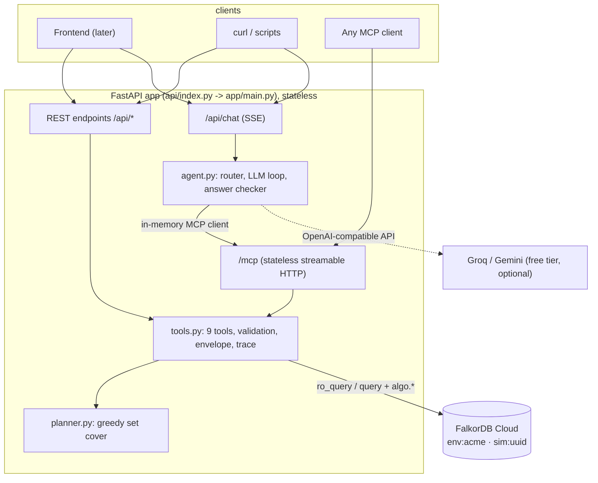

# Architecture (one page)

## The one rule
**One set of tool functions** (`app/tools.py`) backs everything. REST endpoints call them directly,
`app/mcp_server.py` wraps the same functions with typed arguments, and the agent calls them through
MCP. A test proves the MCP result equals the REST result.

## A request, step by step (`POST /api/plan`)
1. FastAPI validates the body (`models.py`), then `tools.plan_remediation` validates it again.
2. Three read queries run (`attack_paths`, `choke_edge_frequency`, `rejected_edges`); each is
   recorded in the response `trace`.
3. `planner.greedy_plan` (pure Python) picks edges: best (new paths cut / disruption), stops when
   nothing remains, never picks an edge that cuts nothing, skips edges rejected in memory.
4. The envelope `{outcome, data, paths, trace, notes}` is returned. Nothing is stored server-side.

## Chat
`/api/chat` runs the agent in its own task and streams its events. With a free LLM configured the
model picks MCP tools (max 6 calls) and writes one sentence, which `check_answer` verifies; on any
failure, rate limit or missing key, the deterministic router answers with a templated sentence.
`record_decision` is never offered to the model: only humans approve or reject.

## Data and memory (all in FalkorDB)
`env:{tenant}` holds assets, `PIVOT` edges, teams, ownership and `Decision` memory. A simulation
copies it to `sim:{uuid}`, edits the copy, and deletes it in a `finally` block (the free Cloud
instance has little memory).

## Serverless constraints honoured
Stateless handlers (no local disk, threads or caches that matter), stateless MCP over HTTP (no
session ids, no stdio subprocess), configuration by environment variables, `requirements.txt`,
CORS configurable, best-effort rate limiting only. FalkorDB runs outside Vercel (Cloud for
deployment; Docker for local, untested). Deployment itself is Phase 8 and has not been done yet.
